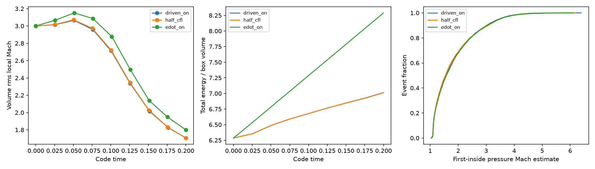

# Forced turbulence with particle shock encounters

Native forcing is allowed with ordinary `shock_tracking/enabled=true`; no extra
opt-in is required. Both `normalization=accel_rms` and `normalization=edot` use
AthenaK's existing driver, tasks, density fluxes and native OU/RNG restart. The
change removes shock-specific forcing policy guards, retaining finite-parameter
checks, the full static forcing restart binding and existing hydro/runtime guards.
No solver, source energy update, particle transport or event layout changed.

Source commit `ad4225edea78d255b67df97fe8f593c0c268fa1e`; compiled fingerprint
`f6195adafb7e6a554c23a7537053bb00e6ae8c618a10ff1951a487d6981cb70b`.
The executable was built from these exact source contents before that commit;
verification.json checks every reported source against the committed code.
Branch `codex/shock-multiphase` derives from `multiphase_turb`. These changes are
local; the last push was at4aebdafb. The earlier opt-in packet remains historical
at `evidence/shocks-mc/forcing-checks-20261013/`.

## What actually passed

30 local Serial CPU/double processes:26 successes and4 expected rejections.
EXT06/CFG01/SYS02: saved fluid, rendered force and all native particle records
match exactly with tracking on/off for both normalizations in the periodic box.
RST01/RST07: generation30 continuation reproduces all events and terminal
censored views, final fluid/OU forcing, and every expected resumed particle row:
49152 for accel_rms and53248 for edot. All4096 IDs survive both periodic cases.
Changed seed/acceleration restart configurations and nonfinite tcorr/dedt reject.
No missing rows or inconvenient events are discarded to obtain these results.

INT06/INT08:896 observations match the completed native fluid generation and
full-double thermo time/position/density exactly, pressure error0 at the unchanged
1e-12 check. Native binary time is checked at its actual six-digit representation.
PHY09: smooth transverse forced shear emits0 complete/partial/suspended episodes.
Fresh state/offline checks,53 exact-mask ShockIt parity fixtures at rtol=atol=1e-12,
20 unforced integration processes and21 held-out physical runs pass. All21
physical measurement dictionaries equal the preceding source's results.

Seven short variants also pass exact saved fluid/force on/off comparisons: tiling,
localization, delayed start, finite-duration drive, physical outflow, Cartesian2D
kz0 forcing and native planar driving. Periodic variants preserve all128 IDs and
particle records exactly. Five pre-start and seven post-cutoff steps have exactly
zero force, checked against actual step-start times, with nonzero force elsewhere.
Other variants establish compatibility/non-interference, not independently correct
forcing envelopes/spectra. Variant-specific restart and full physical calibration
are not established by these short checks.

Outflow is an explicit existing exception to whole-particle on/off equivalence:
the legacy disabled boundary path wraps particles, while tracking deletes physical
outflow and retains encounter censoring. An independent source-position plus
realized-cell-hop oracle accounts for exactly IDs3,77,109 across all16 transfer
generations, with no resurrection. All surviving native records and fluid/force
arrays match exactly. No boundary machinery was changed in this allowance.

## Read the plots beside their limits



Left: the32^3 periodic unit cube starts at rms Mach3 and is forced to t=.2 with
4096 mass-seeded MC particles, gamma1.4, RK2/PLM/HLLC. Accel_rms10 at CFL.30
and.15 ends at rms local Mach1.706/1.707; edot10 at CFL.30 ends at1.800. This
is a short, still evolving realization. Forcing is nonzero, but a stationary
supersonic-turbulence ensemble has not been established.

Middle: total box energy evolves under native forcing. Edot10 is the driver
input target, not an independently calibrated energy-injection claim. Total-energy
growth includes actual forcing work and native numerical source bias; conservative
shock heating is not the same as this bias. Periodic mass is conserved to1e-12.

Right: empirical first-inside pressure-Mach estimates for emitted encounters.
Accel_rms:7063 complete/0 partial/556 open at CFL.30;7744/0/520 at CFL.15.
Edot:7357 complete/0 partial/479 open. Open records are right-censored, and the
curve shows completed events only. The9.64% accel_rms count sensitivity jointly
changes fluid integration, RNG draws and detector sampling; it is not an isolated
cadence/convergence test. Fixed spatial endpoints are not plateau-certified
physical strengths, and numerical encounters are not a calibrated shock catalogue.

## Known native source limitation

The independent thermodynamic oracle remains FAILED: divergence-free transverse
forcing should preserve gas internal energy in the continuum, but the first active
native RK2 step produces mean excess1.318359375e-4 at acceleration rms1 and
dt=.01875. The pointwise excess matches3rho|a|²dt²/8 with error2.36e-16;
momentum is exact. The native driver was left unchanged. The initial OU step is
zero-force, so this check uses the second full step/first active kick. Zero detected
shocks does not imply thermodynamic neutrality. This documented limitation does
not impose a runtime opt-in; human physical strength/energy calibration remains
pending. No scientific sign-off, MPI/GPU/AMR or RUSTY/Frontier performance is claimed.

## Use and reproduce

The input `inputs/tests/shock_mc_forced.athinput` is an ordinary forced box with
tracking enabled and no experimental_forcing parameter. Use a fresh run directory:

```sh
mkdir /tmp/forced-box-new
cd /tmp/forced-box-new
/ABS/WORKTREE/build-release/src/athena \
  -i /ABS/WORKTREE/inputs/tests/shock_mc_forced.athinput
```

For energy-injection normalization, replace `normalization=accel_rms` and
`accel_rms=10` in its turb_driving block with `normalization=edot` and `dedt=10`.
Keep the other forcing settings. The native driver rejects supplying both amplitudes.
Choose a unique lineage/directory for independent runs; keep the entire committed
history directory with its native restart and matching shock sidecar for continuation.
The full resolved static forcing parameters and seed bind restart; changing them
(including equivalent numeric spellings) is a strict mismatch. Native modal/RNG
progress is saved once in the fluid restart. Old-source sidecars need their matching
old executable. The current allowance does not change this persistence contract.

From the feature worktree:

```sh
cmake -S . -B build-release -DCMAKE_BUILD_TYPE=Release -DAthena_SHOCK_TESTS=ON
cmake --build build-release -j8
MPLCONFIGDIR=/tmp/shock-turb-mpl \
/Users/hitesh/hitesh/git/shockit/.venv/bin/python tst/shocks-mc/forcing_checks.py \
  --executable build-release/src/athena \
  --workdir /tmp/shock-forcing-new \
  --output /tmp/shock-forcing-plots-new
```

Both directories must be new; each simulation is capped at180s. NumPy and
Matplotlib use the existing local environment. report.json records every exact
command/input/log/source/executable hash, counts and assertions. Rebuild with
Serial/double/MPI-off for the measured local configuration; other runtime modes
retain their separate qualification requirements. Forced uniform2D/3D ideal hydro
is permitted under the existing constraints; valid native forcing combinations
beyond the enumerated tests are allowed but not individually measured here.

The packet contains input/logs, selected native heat/timing/window/exit fixtures,
paired checkpoint/events, raw-file hashes, all regression reports and three
independent reviews. Preflights are retained: whole-particle outflow equivalence
was an invalid oracle for the preexisting boundary difference; a padded-rank glob
missed transfer files; driving_type1 with kz0 excluded all native modes. Corrected
fixtures preserve exact checks and tolerances. Full raw final runs remain at
/private/tmp/shock-forcing-enabled-qualified-20261013.
